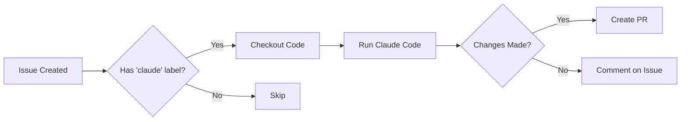
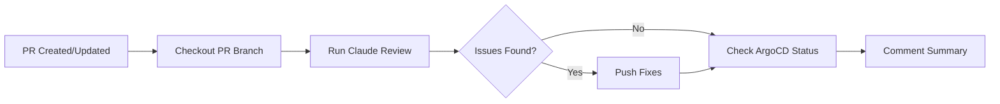

# Claude Automation Guide

> GitHub Actions workflows for automated issue resolution and PR reviews using Claude Code

## Overview

This homelab uses ARC (Actions Runner Controller) to run Claude-powered automation workflows on self-hosted Kubernetes runners.

### Available Workflows

| Workflow | Trigger | Purpose |
|----------|---------|---------|
| `issue-claude.yml` | Issue labeled `claude` or `@claude` mention in comment | Auto-resolve GitHub issues |
| `pr-review.yml` | PR opened/updated or `@claude` in review comment | Auto-review and fix PRs |

## Setup

### 1. Configure GitHub Secrets

Add the Anthropic API key to your repository:

```bash
# Via GitHub CLI
gh secret set ANTHROPIC_API_KEY --body "sk-ant-..."

# Or via GitHub UI:
# Settings → Secrets and variables → Actions → New repository secret
# Name: ANTHROPIC_API_KEY
# Value: sk-ant-...
```

### 2. Deploy RBAC for ARC Runner

The ARC runner needs read-only access to Kubernetes API and ArgoCD Applications.

RBAC is defined in `platform/stacks/01-platforms/overlays/home/arc.yaml`:
- **ClusterRole**: `arc-runner-reader` (read-only permissions)
- **ClusterRoleBinding**: Binds to `homelab-gh-gha-rs-no-permission` ServiceAccount

**Deploy RBAC:**

```bash
# ArgoCD will auto-sync the changes
git add platform/stacks/01-platforms/overlays/home/arc.yaml
git commit -m "feat(arc): add RBAC for runner K8s access"
git push

# Verify RBAC is applied
kubectl get clusterrole arc-runner-reader
kubectl get clusterrolebinding arc-runner-reader

# Test access from a runner pod
kubectl exec -it -n arc-runners <runner-pod-name> -- kubectl get pods -n argocd
```

**Permissions granted:**
- Read pods, services, configmaps, namespaces
- Read ArgoCD Applications, ApplicationSets, AppProjects
- Read deployments, statefulsets, daemonsets
- Read Gateway API resources (HTTPRoute, Gateway)
- Read Infisical secrets (metadata only)

### 3. Verify ARC Runner

Check that the `homelab-gh` runner is active:

```bash
kubectl get pods -n arc-runners
kubectl logs -n arc-runners -l app.kubernetes.io/name=gha-runner-scale-set
```

### 4. Test the Workflows

#### Test Issue Resolution

1. Create a new issue in the repository
2. Add the `claude` label
3. Watch the workflow run in Actions tab
4. Claude will analyze the issue and create a PR if needed

Example issue:
```
Title: Add health check to deepfx deployment
Body: The deepfx.yaml manifest is missing livenessProbe and readinessProbe.
Add health checks following Kubernetes best practices.
```

#### Test PR Review

1. Create a PR with some changes
2. The workflow runs automatically
3. Claude reviews the code and may push fixes
4. Check the PR comments for review summary

Or mention Claude in a review comment:
```
@claude please check the resource limits in this manifest
```

## How It Works

### Issue Resolution Flow



### PR Review Flow



## Kubernetes Integration

### How Claude Queries Cluster State

The workflows run on ARC (Actions Runner Controller) pods inside the Kubernetes cluster, giving Claude access to cluster state via `kubectl`.

**In-cluster authentication:**
```yaml
# Workflow step
- name: Setup kubectl
  run: |
    # ServiceAccount token is auto-mounted at:
    # /var/run/secrets/kubernetes.io/serviceaccount/token

    kubectl get pods -n argocd  # Works via in-cluster config
```

**Checking ArgoCD sync status:**
```bash
# Get Application sync and health status
kubectl get application <app-name> -n argocd \
  -o jsonpath='{.status.sync.status}:{.status.health.status}'

# Example output: Synced:Healthy
```

**Use cases:**
1. **After YAML changes**: Verify ArgoCD synced successfully
2. **During PR review**: Check current app health status
3. **Issue resolution**: Confirm deployment is running after fix

## Workflow Details

### issue-claude.yml

**Triggers:**
- Issue labeled with `claude`
- Issue comment containing `@claude` or `/claude`

**Process:**
1. Extract issue title and description
2. Create a new branch (`claude/issue-{number}`)
3. Run Claude Code with the issue context
4. Commit changes following project standards
5. Create PR or comment on issue

**Self-hosted runner:** `homelab-gh` (ARC in Kubernetes)

### pr-review.yml

**Triggers:**
- PR opened, synchronized, or reopened
- Review comment containing `@claude`

**Process:**
1. Checkout PR branch
2. Get PR diff and description
3. Run Claude Code review with project rules
4. Auto-fix issues if possible
5. Push fixes or comment review summary

**Review criteria:**
- Code quality and best practices
- Security (OWASP, injection vulnerabilities)
- Kubernetes manifest correctness
- ArgoCD application standards
- Resource limits and health checks

## Limitations & Improvements

### Current Limitations

1. **Interactive CLI**: Claude Code is designed for interactive use. The current implementation may not work perfectly in non-interactive mode.

2. **No State Persistence**: Each workflow run is independent. Complex issues requiring multiple iterations may fail.

3. **Rate Limits**: No built-in rate limiting for Anthropic API calls.

### Recommended Improvements

#### Option 1: Use Claude API Directly

Instead of Claude Code CLI, call the Anthropic API directly:

```yaml
- name: Run Claude API
  run: |
    curl https://api.anthropic.com/v1/messages \
      -H "x-api-key: $ANTHROPIC_API_KEY" \
      -H "anthropic-version: 2023-06-01" \
      -H "content-type: application/json" \
      -d '{
        "model": "claude-sonnet-4.5-20250929",
        "max_tokens": 4096,
        "messages": [{"role": "user", "content": "..."}]
      }'
```

#### Option 2: Use Claude Agent SDK

Build a custom agent with Python/Node.js:

```python
from anthropic import Anthropic

client = Anthropic(api_key=os.environ["ANTHROPIC_API_KEY"])

message = client.messages.create(
    model="claude-sonnet-4.5-20250929",
    max_tokens=4096,
    messages=[{"role": "user", "content": prompt}]
)
```

See: https://platform.claude.com/llms.txt

#### Option 3: Docker Container Action

Package Claude Code in a Docker container:

```yaml
- name: Run Claude
  uses: docker://your-registry/claude-code:latest
  with:
    issue_context: ${{ steps.context.outputs }}
```

## Troubleshooting

### Workflow Not Triggering

1. Check ARC runner status:
   ```bash
   kubectl get pods -n arc-runners
   argocd app get arc-runner-scale-set
   ```

2. Verify GitHub webhook delivery:
   - Go to repository Settings → Webhooks
   - Check recent deliveries for errors

### Claude Code Fails

1. Check API key is valid:
   ```bash
   gh secret list
   ```

2. View workflow logs:
   ```bash
   gh run list --workflow=issue-claude.yml
   gh run view <run-id> --log
   ```

### Permission Errors

The workflows need these permissions:
```yaml
permissions:
  contents: write      # Push commits
  issues: write        # Comment on issues
  pull-requests: write # Create PRs and comments
```

Verify in repository Settings → Actions → General → Workflow permissions.

## Cost Management

Monitor Anthropic API usage to control costs:

1. **Set usage limits** in Anthropic Console
2. **Add rate limiting** to workflows:
   ```yaml
   concurrency:
     group: claude-${{ github.event.issue.number }}
     cancel-in-progress: true
   ```

3. **Use labels selectively**: Only add `claude` label to issues that need automation

## Security Considerations

1. **API Key Storage**: Use GitHub Secrets or migrate to Infisical
   ```yaml
   # Future: Use Infisical like GitHub auth in ARC
   - name: Get API Key from Infisical
     run: |
       kubectl get secret -n infisical managed-claude-secrets \
         -o jsonpath='{.data.ANTHROPIC_API_KEY}' | base64 -d
   ```

2. **Review Auto-fixes**: Always review Claude's changes before merging

3. **Limit Scope**: Start with `claude` label requirement to prevent accidental runs

## Next Steps

1. **Test workflows** with sample issues/PRs
2. **Monitor API usage** and adjust as needed
3. **Iterate on prompts** to improve Claude's responses
4. **Consider migrating** to Claude API or Agent SDK for better control
5. **Add to Infisical** for centralized secret management

---

🤖 This automation is powered by Claude Code running on your homelab Kubernetes cluster via ARC.
