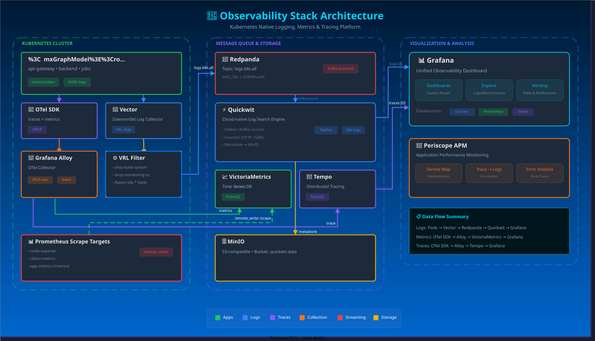

# Homelab

## Observability Stack

> Disclaimer: This document is currently in active development.

This document describes the observability stack architecture for the homelab, designed as a Kubernetes-native platform for logging, metrics, and tracing. 

### Architecture Overview

The stack is composed of three main layers: **Collection**, **Storage & Streaming**, and **Visualization & Analysis**.

#### 1. Kubernetes Cluster (Collection Layer)

This layer is responsible for gathering telemetry data from application pods and infrastructure.

*   **Application Pods**:
    *   Components: `api-gateway`, `backend`, `jobs`.
    *   Outputs: `stdout/stderr` (logs), JSON logs, OTel SDK (traces + metrics).
*   **Vector**:
    *   Role: DaemonSet Log Collector.
    *   Function: Collects `k8s_logs` and forwards them.
    *   **VRL Filter**: Applies transformations such as dropping `kube-system` and `monitoring` namespaces, and flattening `k8s.*` fields.
*   **Grafana Alloy (OTel Collector)**:
    *   Role: OpenTelemetry Collector.
    *   Function: Receives OTLP data (traces & metrics), batches it, and forwards it to storage backends.
*   **Prometheus Scrape Targets**:
    *   Sources: `node-exporter`, `cilium metrics`, app metrics (`/metrics`).
    *   Method: `remote_write` to storage.

#### 2. Message Queue & Storage

This layer handles the persistence and buffering of telemetry data.

*   **Redpanda**:
    *   Role: Kafka-compatible Message Queue.
    *   Topic: `logs.k8s.all`.
    *   Auth: SASL_SSL + SCRAM.
    *   Function: Buffers logs from Vector before indexing.
*   **Quickwit**:
    *   Role: Cloud-native Log Search Engine.
    *   Components:
        *   **Indexer**: Consumes from Kafka (Redpanda).
        *   **Searcher**: Serves queries via HTTP (`:7280`).
        *   **Metastore**: Stores metadata in MinIO.
    *   Tags: Tantivy, k8s-logs.
*   **VictoriaMetrics**:
    *   Role: Time Series Database (PromQL).
    *   Function: Stores metrics from Alloy and Prometheus targets.
*   **Tempo**:
    *   Role: Distributed Tracing (TraceQL).
    *   Function: Stores traces from Alloy.
*   **MinIO**:
    *   Role: S3-compatible Object Storage.
    *   Bucket: `quickwit-data`.
    *   Function: Backend storage for Quickwit.

#### 3. Visualization & Analysis

This layer provides the user interface for monitoring and debugging.

*   **Grafana**:
    *   Role: Unified Observability Dashboard.
    *   Features:
        *   **Dashboards**: Custom panels.
        *   **Explore**: Ad-hoc queries for Logs, Metrics, and Traces.
        *   **Alerting**: Rules and notifications.
    *   **Datasources**:
        *   Quickwit (Logs)
        *   Prometheus (Metrics - via VictoriaMetrics)
        *   Tempo (Traces)
*   **Pyroscope APM**:
    *   Role: Application Performance Monitoring.
    *   Features:
        *   **Service Map**: Visualizes dependencies.
        *   **Trace -> Logs**: Correlates traces with logs.
        *   **Error Analysis**: Root cause analysis.

### Data Flow Summary

*   **Logs Flow**:
    `Pods` -> `Vector` -> `VRL Filter` -> `Redpanda` -> `Quickwit` -> `Grafana`
*   **Metrics Flow**:
    `OTel SDK` -> `Alloy` -> `VictoriaMetrics` -> `Grafana`
*   **Traces Flow**:
    `OTel SDK` -> `Alloy` -> `Tempo` -> `Grafana`

### Real-time Log Search Considerations

Quickwit is designed for high-volume, cost-efficient log storage on object storage (like S3/MinIO). By design, it batches data before indexing and uploading to object storage to optimize for throughput and storage costs. This architecture introduces a small ingestion latency (typically seconds to minutes), meaning it does not support true real-time "tailing" of logs.

To address this, we implement a **Hybrid Storage Strategy**:
*   **Hot Storage (Loki or VictoriaLogs)**: Used for real-time log ingestion and "live tailing" (e.g., last 24 hours). This provides immediate visibility for debugging.
*   **Cold Storage (Quickwit)**: Used for long-term retention and high-volume analytics. Logs are archived here for cost-efficiency.